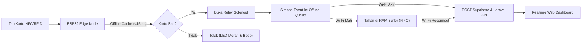

# 🔐 NFCKey: Smart NFC Attendance & Door Access System

<div align="center">
  
  
  
  
  
  
</div>

<br />

> **Sistem Absensi dan Kontrol Akses Pintu Cerdas Tingkat Enterprise Berbasis IoT ESP32, NFC PN532, Laravel REST API, dan Real-Time React Dashboard.**

Proyek **NFCKey** adalah solusi sistem kontrol akses pintu dan presensi berbasis *Internet of Things* (IoT) yang dibangun sebagai proyek akhir Project-Based Learning (PJBL). Sistem ini mengintegrasikan mikrokontroler **ESP32**, teknologi **NFC** (prioritas utama dengan modul PN532 V3) dan **RFID** (cadangan dengan modul MFRC522), kendali solenoid lock *fail-secure* dengan proteksi *safe cold-boot*, sensor magnetik pintu (*Reed Switch*), penyimpanan *offline-first* dengan jaminan *zero data loss*, backend REST API **Laravel** dengan proteksi *idempotency*, serta dashboard web **React 19** dengan sinkronisasi *real-time WebSocket*.

---

## ⚡ Wokwi Interactive Hardware Simulation

Sistem ini telah dilengkapi dengan sirkuit dan kode simulasi perangkat keras interaktif yang dapat langsung diuji coba di **[Wokwi Simulator](https://wokwi.com)** atau melalui ekstensi **Wokwi for VS Code** langsung dari repositori ini!

<div align="center">
  <a href="https://wokwi.com">
    
  </a>
</div>

### 🖥️ Skema Diagram Sirkuit Wokwi

```text
                                +---------------------------+
                                |      WOKWI SIMULATOR      |
                                |                           |
  [LED Hijau (Akses)]  ──GPIO 32── [ ] ESP32 DevKit v4  [ ] ──GPIO 5 (SS)── [MFRC522 RFID Reader]
  [LED Merah (Tolak)]  ──GPIO 33── [ ]                  [ ] ──GPIO 18(SCK)── [UID: 04:a3:92:7f]
  [LED Kuning (Alarm)] ──GPIO 25── [ ]                  [ ] ──GPIO 19(MISO)
  [Reed Switch MC-38]  ──GPIO 27── [ ]                  [ ] ──GPIO 23(MOSI)
  [Piezo Buzzer 5V]    ──GPIO 14── [ ]                  [ ] ──GPIO 22(RST)
  [Relay 5V Module]    ──GPIO 26── [ ]                  [ ]
          │                           [ COM ]    [ NO ]
          └──────────────────────────────┴──────────┴────> [LED Biru Solenoid Lock]
```

### 🎮 Cara Menjalankan Simulasi Wokwi:

#### Opsi 1: Melalui Browser (Wokwi Web)
1. Kunjungi **[wokwi.com](https://wokwi.com)** dan pilih proyek **ESP32**.
2. Salin seluruh isi file [`diagram.json`](./diagram.json) ke tab **`diagram.json`** di Wokwi.
3. Salin seluruh isi file [`firmware/esp32/wokwi_simulation/wokwi_sketch.ino`](./firmware/esp32/wokwi_simulation/wokwi_sketch.ino) ke tab **`sketch.ino`** di Wokwi.
4. Buka tab **Library Manager** dan tambahkan library **`MFRC522`**.
5. Klik tombol **Start Simulation** (Hijau).

#### Opsi 2: Langsung di VS Code (1-Click Run)
1. Pasang ekstensi **Wokwi Simulator** di VS Code.
2. Buka workspace repositori ini. File [`wokwi.toml`](./wokwi.toml) dan [`diagram.json`](./diagram.json) di root folder sudah terkonfigurasi otomatis.
3. Tekan `F1`, ketik dan pilih: **`Wokwi: Start Simulator`**.

### 🧪 Skenario Pengujian Interaktif Wokwi:
- **🟢 Tap Kartu Sah (UID `04:A3:92:7F`):**
  Klik modul MFRC522 $\rightarrow$ pilih kartu biru. Relay aktif berbunyi klik, indikator **Solenoid Lock (Biru)** menyala, **LED Hijau** menyala, buzzer berbunyi 2x ceria, dan log presensi langsung terkirim ke database Supabase melalui Wi-Fi virtual `Wokwi-GUEST`.
- **🔴 Tap Kartu Asing (UID `AA:BB:CC:DD`):**
  Klik modul MFRC522 $\rightarrow$ pilih kartu merah. **LED Merah** menyala, buzzer membunyikan nada rendah peringatan, solenoid tetap terkunci, dan log penolakan tercatat di sistem audit.
- **🚪 Simulasi Sensor Magnet Pintu (Reed Switch):**
  Geser **Slide Switch (GPIO 27)** untuk membuka pintu fisik. Geser kembali untuk menutup pintu $\rightarrow$ solenoid dan relay langsung mengunci seketika!
- **⏳ Auto-Relock 5 Detik:**
  Tap kartu sah namun biarkan switch tetap tertutup $\rightarrow$ sistem mengunci kembali secara otomatis setelah 5 detik.
- **⚠️ Alarm Pintu Terbuka >30 Detik (Door Ajar):**
  Geser slide switch ke posisi terbuka dan biarkan >30 detik $\rightarrow$ **LED Kuning** berkedip cepat dan buzzer berbunyi intermiten hingga switch dirapatkan kembali.

---

## 🌟 Fitur & Keunggulan Arsitektur



1. **Dual NFC/RFID Technology:**
   - **NFC PN532 V3 Merah (Prioritas):** Mendukung smart tag, e-Money, kartu mahasiswa/pelajar, dan smartphone emulasi NFC.
   - **MFRC522 RFID (Cadangan):** Mendukung kartu Mifare Classic 1K dan RFID keyfob dengan gain antena maksimum (+48dB).
2. **Reliabilitas 100% Offline-First:**
   - Kehilangan koneksi Wi-Fi atau server down **tidak pernah** menghentikan operasional pintu atau menghilangkan data presensi.
   - Event disimpan dalam buffer RAM (FIFO Ring Buffer) dan disinkronkan otomatis saat jaringan internet pulih kembali (*idempotent queue drain*).
3. **Safe Cold-Boot Relay Protection:**
   - Firmware mengatur tingkat logika output relay ke status aman sebelum inisialisasi pinout. Menjamin relay tidak berbunyi klik (*anti-glitch*) saat mikrokontroler pertama kali menyala atau restart mendadak.
4. **Proteksi Idempotensi Transaksi:**
   - Setiap tap menghasilkan `event_id` unik (UUIDv4). Percobaan transmisi ulang berkali-kali tidak akan pernah menghasilkan rekaman ganda pada database.
5. **Gateway Liveness & Dynamic Heartbeat:**
   - ESP32 mengirim sinyal detak jantung berkala setiap 20 detik ke tabel `devices`. Web Dashboard mendeteksi status live online/offline gerbang secara dinamis (<45 detik threshold).
6. **Portal Web Multi-Role & Real-Time:**
   - Dibangun dengan React 19, TypeScript, dan Tailwind CSS.
   - Sinkronisasi WebSocket Supabase untuk visualisasi instan tanpa perlu refresh halaman manual.
   - Ekspor data laporan absensi ke format **CSV**.
   - Manajemen lengkap: Pengguna, Kartu RFID/NFC, Gerbang IoT, dan Konfigurasi Sistem.

---

## 📸 Dokumentasi Bukti 6 Kondisi Operasional Fisik

Sistem telah diuji dan divalidasi terhadap **6 Kondisi Operasional Nyata** dengan bukti dokumentasi foto pada folder [`docs/conditions/`](./docs/conditions/):

| Kondisi | Foto Dokumentasi | Hasil Pengujian Lapangan |
| :--- | :---: | :--- |
| **Condition 1: Normal Operation** | [`condition1.jpg`](./docs/conditions/condition1.jpg) | Tap kartu sah $\rightarrow$ Solenoid terbuka $\rightarrow$ LED Hijau ON $\rightarrow$ Pintu dibuka $\rightarrow$ Pintu ditutup $\rightarrow$ Solenoid mengunci instan $\rightarrow$ Log tersimpan di cloud. |
| **Condition 2: Safe Cold-Boot** | [`condition2.jpg`](./docs/conditions/condition2.jpg) | Sistem dialiri listrik $\rightarrow$ Relay aman tanpa glitch/clicking $\rightarrow$ Solenoid tetap terkunci rapat $\rightarrow$ LED Kuning mencari Wi-Fi. |
| **Condition 3: Access Denied** | [`condition3.jpg`](./docs/conditions/condition3.jpg) | Kartu asing ditempelkan $\rightarrow$ Solenoid tetap terkunci $\rightarrow$ LED Merah menyala $\rightarrow$ Buzzer berbunyi nada tolak $\rightarrow$ Percobaan akses ilegal tercatat. |
| **Condition 4: Door Ajar Alert** | [`condition4.jpg`](./docs/conditions/condition4.jpg) | Pintu ditahan terbuka >30 detik $\rightarrow$ LED Kuning berkedip cepat $\rightarrow$ Buzzer berbunyi peringatan intermiten $\rightarrow$ Padam saat pintu ditutup rapat. |
| **Condition 5: Forced Entry Alarm** | [`condition5.jpg`](./docs/conditions/condition5.jpg) | Pintu dibuka paksa tanpa tap kartu $\rightarrow$ Sirine darurat kencang menyala $\rightarrow$ LED Merah berkedip *strobe* $\rightarrow$ Alert darurat terkirim ke web. |
| **Condition 6: Offline-First Operation** | [`condition6.jpg`](./docs/conditions/condition6.jpg) | Wi-Fi diputus $\rightarrow$ Tap kartu tetap membuka pintu $\rightarrow$ Event tersimpan di antrean lokal $\rightarrow$ Wi-Fi dinyalakan kembali $\rightarrow$ Sinkronisasi otomatis ke cloud. |

---

## 📂 Struktur Repositori (Clean & Clutter-Free)

Repositori disusun secara rapi, modular, dan bersih tanpa file sampah atau binary build yang tidak perlu:

```text
FinalProject/
├── .gitignore                      # Konfigurasi ignore file komprehensif
├── LICENSE                         # Lisensi Open-Source MIT
├── README.md                       # Dokumentasi utama proyek
├── PROJECT_BRIEF.md                # Spesifikasi dan persyaratan formal sistem
├── diagram.json                    # Skema sirkuit simulasi Wokwi di root
├── wokwi.toml                      # Konfigurasi Wokwi Simulator di root
│
├── firmware/                       # Kode sumber mikrokontroler ESP32
│   ├── README.md                   # Panduan firmware umum
│   └── esp32/
│       ├── platformio.ini          # Konfigurasi build PlatformIO (hardware_irl)
│       ├── diagram.json            # Skema sirkuit simulator Wokwi
│       ├── wokwi.toml              # Konfigurasi Wokwi simulator
│       ├── .env.example            # Template kredensial Wi-Fi & API
│       ├── README.md               # Panduan teknis firmware & pinout lengkap
│       ├── NFCKey_Hardware_IRL/    # Firmware Prototipe Fisik (Arduino / PIO Multi-Tab)
│       │   ├── NFCKey_Hardware_IRL.ino
│       │   ├── Config.h
│       │   ├── DoorModule.ino
│       │   ├── NfcModule.ino
│       │   ├── NetworkModule.ino
│       │   └── README.md
│       ├── wokwi_simulation/       # Firmware Simulasi Mandiri Wokwi
│       │   ├── wokwi_sketch.ino
│       │   ├── diagram.json
│       │   ├── wokwi.toml
│       │   ├── libraries.txt
│       │   └── README.md
│       └── src/                    # Source code C++ modular alternatif
│
├── backend/                        # Layanan Backend & REST API
│   ├── README.md                   # Ringkasan layanan backend
│   └── laravel/                    # Framework Laravel 11/12/13 REST API
│       ├── app/Http/Controllers/   # Controller Auth, Tap, Devices, Cards, Users
│       ├── app/Models/             # Eloquent Models (User, Card, Attendance, Device)
│       ├── database/migrations/    # Migrasi skema database relasional
│       ├── database/seeders/       # Seeder default admin, worker, dan device
│       ├── routes/api.php          # 27 REST API Routes lengkap
│       ├── tests/                  # PHPUnit automated tests
│       ├── .env.example            # Konfigurasi environment backend
│       └── README.md               # Panduan instalasi dan pengujian API
│
├── frontend/                       # Antarmuka Pengguna Berbasis Web
│   ├── README.md                   # Ringkasan frontend
│   └── react/                      # Single Page Application React 19 + TypeScript
│       ├── src/components/         # Dashboard, Logs, Cards, Devices, Users, Settings
│       ├── src/contexts/           # AuthContext (Multi-role & session)
│       ├── src/supabase.ts         # Supabase client & Realtime WebSocket
│       ├── src/App.tsx             # Root layout & Live Clock
│       ├── package.json            # Konfigurasi paket npm/deno
│       └── README.md               # Panduan frontend dashboard
│
├── docs/                           # Dokumentasi Teknis Sistem Lengkap
│   ├── ARCHITECTURE.md             # Desain arsitektur, sequence diagram, dataflow
│   ├── API.md                      # Kontrak spesifikasi seluruh REST API endpoint
│   ├── DATABASE.md                 # ERD basis data, skema tabel, indeks, triggers
│   ├── HARDWARE.md                 # Spesifikasi BOM hardware, wiring pinout, power
│   ├── HARDWARE_IDENTIFICATION.md  # Panduan identifikasi fisik komponen
│   ├── FIRMWARE.md                 # Detail rekayasa firmware & state machine
│   ├── SECURITY.md                 # STRIDE threat model, RBAC, proteksi fail-secure
│   ├── TESTING.md                  # Matriks pengujian lengkap & 15 kriteria DoD
│   ├── MVP.md                      # Verifikasi 100% ketercapaian cakupan MVP
│   ├── IMPLEMENTATION_PLAN.md      # Rencana implementasi (Phase 0 - 8 Selesai)
│   ├── PROPOSAL.md                 # Proposal resmi PJBL kelompok
│   ├── RAB.md                      # Rencana & realisasi anggaran biaya aktual (Rp)
│   ├── DENAH_PROYEK.md             # Denah fisik penempatan modul pada kusen pintu
│   ├── DEPLOYMENT.md               # Panduan peluncuran produksi & demo-day checklist
│   ├── NFC_TESTING_GUIDE.md        # Panduan pengujian tag NFC, e-Money, dan smartphone
│   ├── contribution_progress.html  # Pelacak kontribusi tim
│   └── conditions/                 # Foto dokumentasi 6 kondisi operasional fisik
│       ├── condition1.jpg
│       ├── condition2.jpg
│       ├── condition3.jpg
│       ├── condition4.jpg
│       ├── condition5.jpg
│       └── condition6.jpg
│
└── ToolsImage/                     # Galeri foto referensi komponen hardware
```

---

## 🔌 Tabel Wiring Pinout Hardware

| Komponen | Pin Modul | Pin ESP32 (32-Pins) | Fungsi & Keterangan |
| :--- | :---: | :---: | :--- |
| **NFC PN532 V3** | `SCK` | **GPIO 18** | SPI Bus Clock (VSPI) |
| | `MISO` | **GPIO 19** | SPI Master In Slave Out |
| | `MOSI` | **GPIO 23** | SPI Master Out Slave In |
| | `SDA / SS` | **GPIO 5** | SPI Chip Select |
| | `RSTPD_N` | **GPIO 22** | Reset Pin |
| **Relay Solenoid** | `IN` | **GPIO 26** | Kontrol Solenoid Lock (Active LOW) |
| **Reed Switch (MC-38)**| Kabel 1 | **GPIO 27** | Sensor Daun Pintu (`INPUT_PULLUP`, kabel 2 ke GND) |
| **LED Hijau** | Anoda (+) | **GPIO 32** | Indikator Akses Diterima (Resistor 220 $\Omega$) |
| **LED Merah** | Anoda (+) | **GPIO 33** | Indikator Akses Ditolak & Strobe (Resistor 220 $\Omega$) |
| **LED Kuning** | Anoda (+) | **GPIO 25** | Indikator Status Wi-Fi & Door Ajar (Resistor 220 $\Omega$) |
| **Active Buzzer** | `I/O` (S) | **GPIO 14** | Audio Feedback & Sirine Darurat (Modul 3-Pin) |
| **Catu Daya Sensor** | `VCC` | **3V3** | Daya 3.3V untuk Modul PN532 / RC522 |
| **Catu Daya Aktuator** | `VCC` | **VIN / 5V** | Daya 5.0V dari Step-Down LM2596 |
| **Ground** | `GND` | **GND** | Ground Bersama (Common Ground) |

---

## 🚀 Panduan Memulai Cepat (Quickstart Guide)

### 1. Menjalankan Backend Laravel
```bash
cd backend/laravel
composer install
cp .env.example .env
php artisan key:generate
php artisan migrate --seed
php artisan serve
```

### 2. Menjalankan Frontend React Dashboard
```bash
cd frontend/react
npm install
npm run dev
```
Buka browser pada `http://localhost:5173`. Login menggunakan:
- Email: `admin@nfckey.com`
- Password: `password123`

### 3. Upload Firmware ESP32
```bash
cd firmware/esp32
pio run -e hardware_irl -t upload
pio device monitor -b 115200
```

---

## 👥 Tim Pengembang (Kelompok Medan — PJBL Proyek 5)

1. **Mahardika Putra (01)** — *Ketua Kelompok & Integrasi Sistem*
2. **Quinn Felicia Ghani Azalia (18)** — *Desain Arsitektur & Dokumentasi*
3. **Mentari Puja Carisha (03)** — *Pengembangan Frontend React*
4. **Maritza Cordelia Ardani (02)** — *Rencana Anggaran Biaya & Pengujian*
5. **Ragnal Averroes A.R (21)** — *Pengembangan Backend Laravel & API*
6. **Muhammad Haidar Bima Aqil (10)** — *Perakitan Hardware & Rangkaian Daya*
7. **Rafa Lazuardi Alyamsah (19)** — *Pengembangan Firmware ESP32 & Wokwi*

---

## 📜 Lisensi

Proyek ini dilisensikan di bawah lisensi terbuka [MIT License](LICENSE).
