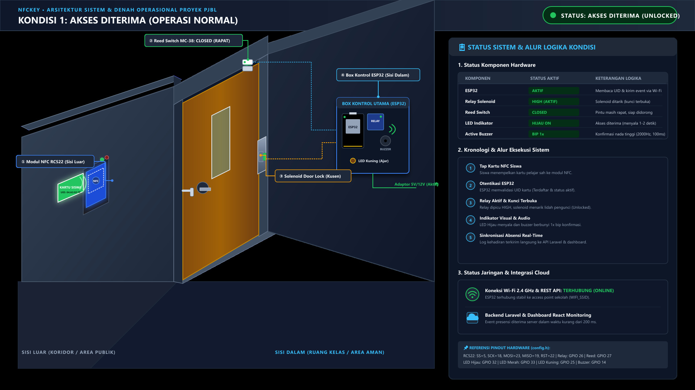
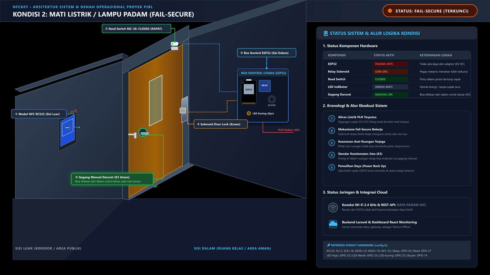
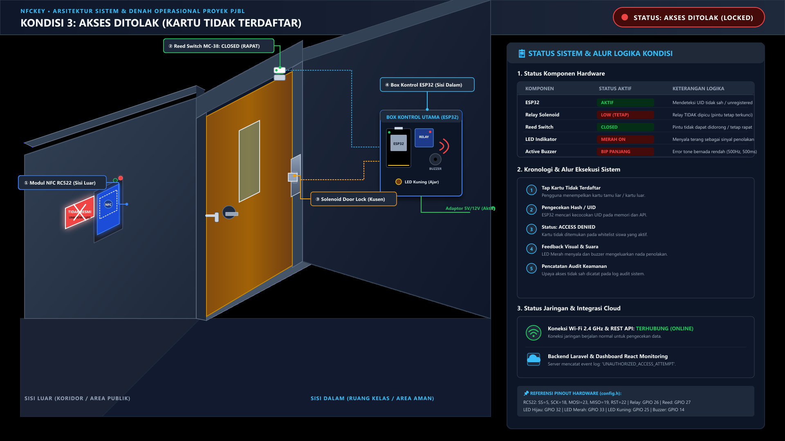
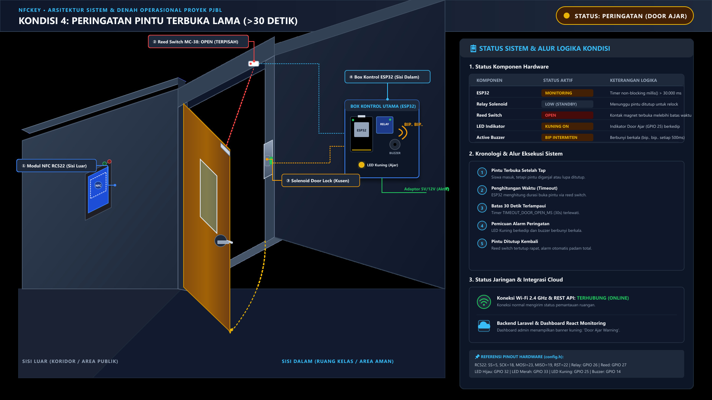
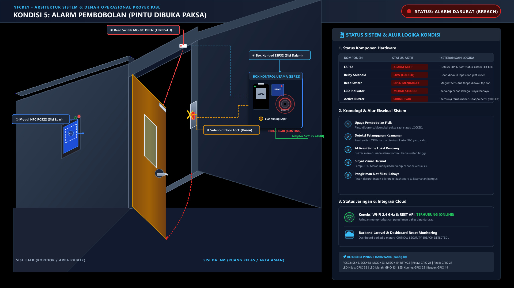
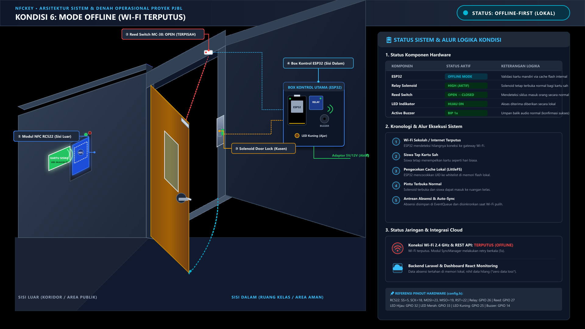

# 🚦 Matriks 6 Kondisi Operasional Fisik — NFCKey ESP32

Dokumentasi detail spesifikasi operasional, skenario pengujian, logika firmware, serta bukti fotografis untuk **6 Kondisi Operasional (Condition 1 s.d. 6)** pada sistem **NFCKey (Smart NFC Attendance & Door Access System)**.

Dokumen ini disusun selaras dengan implementasi firmware final pada [`firmware/esp32/NFCKey_Hardware_IRL/`](../firmware/esp32/NFCKey_Hardware_IRL/).

---

## 🟢 Condition 1: Normal Access (Operasi Standar Akses Diterima)



### 📋 Skenario:
Siswa/pengguna menempelkan kartu NFC/RFID yang sah dan terdaftar pada sistem (misal UID `04:A3:92:7F` atas nama *Siswa Teladan*). Daya listrik normal dan jaringan Wi-Fi terhubung.

### ⚙️ Logika & Implementasi Firmware:
1. **Pemindaian & Pencocokan UID (`NfcModule.ino`):**
   * Modul PN532 (SPI) atau RC522 membaca UID kartu secara non-blocking.
   * Fungsi `nfc_is_card_valid(uid)` memverifikasi UID terhadap whitelist permanen dan *dynamic cloud cache*. Waktu eksekusi validasi **<15 milidetik**.
2. **Pengaktifan Aktuator & Indikator (`DoorModule.ino`):**
   * Relay solenoid diaktifkan (`digitalWrite(PIN_DOOR_RELAY, RELAY_TRIGGER_ON)` dengan logika **Active LOW**).
   * Daya 12V mengalir ke koil solenoid lock $\rightarrow$ plunger lidah kunci ditarik ke dalam (*Door Unlocked*).
   * **LED Hijau (GPIO 32)** menyala terang.
   * **Piezo Buzzer (GPIO 14)** membunyikan nada konfirmasi akses (2 ketukan nada ceria: 1800 Hz dan 2400 Hz).
3. **Mekanisme Pintu & Reed Switch MC-38:**
   * Status mesin pintu berpindah ke `DoorState::UNLOCKED_WAITING` dengan jendela waktu 5 detik (`UNLOCK_HOLD_TIME_MS = 5000`).
   * Pengguna mendorong daun pintu $\rightarrow$ magnet MC-38 menjauh $\rightarrow$ `PIN_REED_SWITCH` bernilai `HIGH` (`DoorState::DOOR_OPEN`).
   * Pengguna melewati pintu dan daun pintu kembali merapat $\rightarrow$ magnet MC-38 menempel $\rightarrow$ `PIN_REED_SWITCH` bernilai `LOW` (`CLOSED`).
   * **Relock Instan:** Relay langsung dinonaktifkan seketika (`RELAY_TRIGGER_OFF = HIGH`), LED Hijau padam, dan status kembali ke `DoorState::LOCKED`.
4. **Pencatatan Presensi ke Cloud (`NetworkModule.ino`):**
   * Firmware membuat `event_id` unik (UUIDv4) dan mengirimkan payload HTTP POST ke Supabase REST API (`/rest/v1/attendances`) dan Laravel API (`/api/attendance/tap`).
   * Data langsung ter-streaming secara real-time ke web dashboard via WebSocket Supabase.

---

## ⚡ Condition 2: Safe Cold-Boot & Anti-Glitch Relay (Booting Aman & Mati Listrik)



### 📋 Skenario:
Sistem dihubungkan ke sumber listrik (cold-boot), terjadi restart mendadak, atau terjadi pemadaman listrik PLN total (*Power Outage*).

### ⚙️ Logika & Implementasi Firmware:
1. **Prinsip Fail-Secure Solenoid:**
   * Solenoid lock berjenis *Fail-Secure (Normally Closed)*. Tanpa suplai arus listrik (0V DC), pegas mekanis mendorong lidah solenoid tetap menancap di pelat kusen pintu.
   * **Keamanan Ruangan Terjamin:** Pintu tetap berada dalam kondisi **TERKUNCI RAPAT** saat listrik padam total, mencegah akses ilegal dari pihak luar.
   * **Evakuasi Darurat (Life-Safety Egress):** Di sisi dalam ruangan disediakan gagang manual darurat (*mechanical thumbturn*) sehingga evakuasi keluar ruangan dapat dilakukan tanpa listrik.
2. **Proteksi Anti-Clicking / Anti-Glitch Relay (`door_init()`):**
   * Pada modul relay optocoupler *Active LOW*, jika pin output langsung diatur ke `OUTPUT` sebelum didefinisikan statusnya, relay rentan terpicu sesaat (*glitch click* 20-50ms) yang dapat membuka kunci pintu.
   * Firmware mengatasi kerentanan ini dengan menulis status non-aktif (`HIGH`) ke register hardware **sebelum** fungsi `pinMode()` dieksekusi:
     ```cpp
     digitalWrite(PIN_DOOR_RELAY, RELAY_TRIGGER_OFF); // Set HIGH dulu
     pinMode(PIN_DOOR_RELAY, OUTPUT);                // Baru aktifkan output mode
     ```
3. **Indikasi Status Jaringan saat Boot:**
   * **LED Kuning (GPIO 25)** berkedip (*blinking*) selama ESP32 melakukan negosiasi koneksi Wi-Fi.
   * Setelah IP address didapatkan, LED Kuning menyala stabil (*solid ON*), menandakan sistem siap beroperasi.

---

## 🔴 Condition 3: Access Denied (Akses Ditolak / Kartu Tidak Terdaftar)



### 📋 Skenario:
Seseorang menempelkan kartu RFID/NFC yang tidak dikenal (misal UID `AA:BB:CC:DD`) atau kartu yang statusnya telah dinonaktifkan (`is_active = false`) oleh administrator.

### ⚙️ Logika & Implementasi Firmware:
1. **Pengecekan Otorisasi (`NfcModule.ino`):**
   * UID dibaca dan diverifikasi terhadap database/cache lokal. Hasil: `nfc_is_card_valid()` menghasilkan `false`.
2. **Tindakan Keamanan Aktuator:**
   * Relay solenoid **TETAP PADAM (HIGH)** $\rightarrow$ Solenoid tetap mengunci rapat. Pintu **TIDAK** terbuka.
3. **Audio-Visual Feedback Penolakan (`DoorModule.ino`):**
   * **LED Merah (GPIO 33)** menyala terang selama 1 detik.
   * **Piezo Buzzer (GPIO 14)** membunyikan nada rendah panjang (*low-pitch error beep* 400 Hz selama 600 milidetik).
4. **Pencatatan Audit Keamanan (`NetworkModule.ino`):**
   * Event penolakan tetap dicatat dan dikirimkan ke cloud dengan status `"Ditolak"`.
   * Log penolakan ini dapat dipantau administrator di web dashboard sebagai audit upaya akses tanpa izin.

---

## ⚠️ Condition 4: Door Ajar Alert (Pintu Terbuka Terlalu Lama > 30 Detik)



### 📋 Skenario:
Pintu telah berhasil dibuka setelah tap kartu sah, namun pengguna lupa menutup pintu atau mengganjal daun pintu melebihi batas toleransi waktu aman (`TIMEOUT_DOOR_OPEN_MS = 30000`).

### ⚙️ Logika & Implementasi Firmware:
1. **Penghitungan Waktu Terbuka Non-Blocking (`DoorModule.ino`):**
   * Saat pintu dibuka, sistem mencatat waktu awal: `doorOpenedTime = millis()`.
   * Selama `door_is_open_physically()` bernilai `true` (reed switch MC-38 terbuka / `HIGH`), loop terus menghitung durasi:
     ```cpp
     if (millis() - doorOpenedTime >= TIMEOUT_DOOR_OPEN_MS) {
         currentDoorState = DoorState::DOOR_AJAR;
     }
     ```
2. **Peringatan Pintu Terbuka (Door Ajar Active):**
   * **LED Kuning (GPIO 25)** berkedip cepat (*amber warning strobe*).
   * **Piezo Buzzer (GPIO 14)** membunyikan nada peringatan intermiten (*Beep... Beep...* secara berulang).
   * ESP32 mengirimkan status peringatan ke dashboard web.
3. **Pemulihan Otomatis saat Pintu Ditutup:**
   * Segera setelah pintu didorong rapat kembali hingga kontak reed switch tersambung (`LOW`):
   * Alarm buzzer dan LED Kuning langsung mati seketika.
   * Solenoid kembali mengunci rapat dan sistem kembali ke status `LOCKED`.

---

## 🚨 Condition 5: Forced Entry Alarm (Pintu Dibobol / Didobrak Paksa)



### 📋 Skenario:
Daun pintu dibuka secara paksa (didobrak, dicongkel, atau ditarik paksa) saat sistem berada dalam status terkunci (`LOCKED`) tanpa adanya otorisasi tap kartu sah sebelumnya.

### ⚙️ Logika & Implementasi Firmware:
1. **Deteksi Pembobolan Seketika (`DoorModule.ino`):**
   * Saat sistem berada dalam status `DoorState::LOCKED`, reed switch MC-38 dipantau terus-menerus.
   * Jika nilai sensor berubah mendadak dari `LOW` (tertutup) menjadi `HIGH` (terbuka):
     ```cpp
     if (currentDoorState == DoorState::LOCKED && door_is_open_physically()) {
         Serial.println("[ALARM] 🚨 PEMBOBOLAN TERDETEKSI! Pintu dibuka tanpa otorisasi!");
         currentDoorState = DoorState::FORCED_ENTRY;
     }
     ```
2. **Respons Alarm Darurat:**
   * **Piezo Buzzer (GPIO 14)** membunyikan sirine darurat berkecepatan tinggi secara kontinu (*high-frequency continuous emergency siren*).
   * **LED Merah (GPIO 33)** berkedip cepat (*high-speed emergency strobe*).
   * Modul jaringan mengirimkan log insiden prioritas tinggi ke web dashboard untuk memicu notifikasi peringatan (*Security Alert*).
3. **Penyelesaian Alarm:**
   * Sirine alarm hanya padam setelah pintu fisik ditutup rapat kembali atau di-reset oleh kartu pengawas/admin.

---

## 📡 Condition 6: Offline-First Operation (Wi-Fi / Server Down)



### 📋 Skenario:
Daya listrik ruangan menyala normal, namun koneksi router Wi-Fi sekolah terputus atau server cloud/backend mengalami downtime.

### ⚙️ Logika & Implementasi Firmware:
1. **Otonomi Edge Computing:**
   * ESP32 **tidak pernah** bergantung pada internet untuk membuka pintu.
   * Siswa menempelkan kartu sah $\rightarrow$ diverifikasi seketika via cache RAM internal $\rightarrow$ Solenoid membuka pintu secara normal dan LED Hijau menyala.
2. **Penyimpanan Antrean Offline (FIFO Buffer):**
   * Event presensi dibuat lengkap dengan UUID unik (`event_id`), UID kartu, timestamp, dan status `"Diterima"`.
   * Event disimpan ke dalam **RAM Ring Buffer FIFO** (`queueBuffer[30]`):
     ```cpp
     queue_push(event); // Tersimpan aman di memori lokal
     ```
3. **Sinkronisasi Otomatis saat Jaringan Pulih (Auto-Drain Queue):**
   * Komponen `wifi_update()` terus memantau status jaringan di latar belakang tanpa menghambat pembacaan NFC.
   * Begitu status Wi-Fi kembali `WL_CONNECTED`:
     * Modul `NetworkModule.ino` otomatis mendeteksi koneksi pulih.
     * Mengirimkan seluruh antrean presensi satu per satu secara berurutan (*batch drain*).
     * Menerapkan prinsip **Delete-Only-on-Confirmation**: Rekaman hanya dihapus dari antrean jika server merespons HTTP 200/201 (termasuk status `{ duplicate: true }`).
   * **Hasil:** 100% data absensi terselamatkan tanpa ada satu pun rekaman yang hilang (*Zero Data Loss*).
