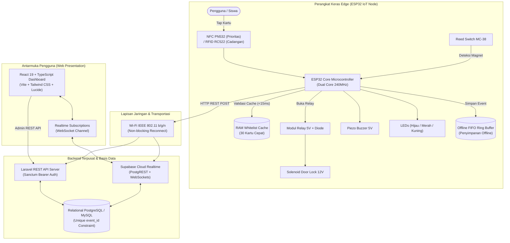
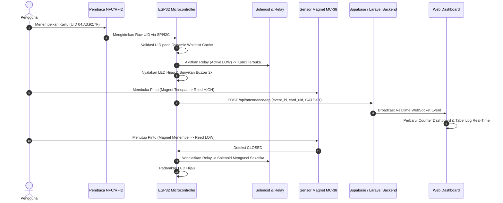
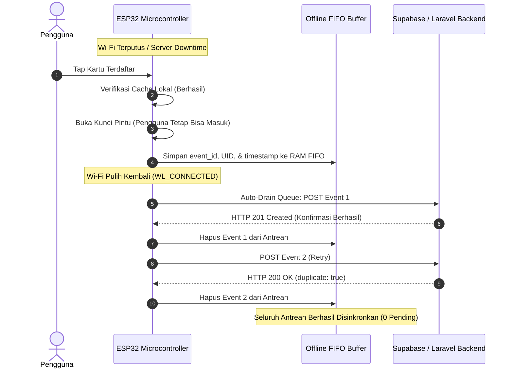
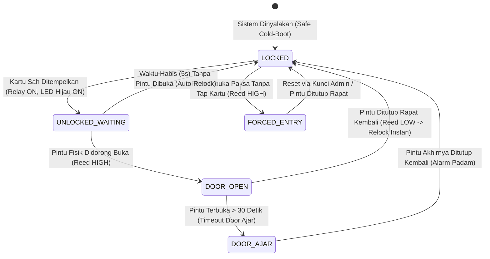

# 🏗️ System Architecture — NFCKey Smart Access & Attendance

Dokumentasi arsitektur sistem lengkap untuk **NFCKey (Smart NFC Attendance & Door Access System)**. Dokumen ini menjelaskan rancangan rekayasa sistem terdistribusi, batas tanggung jawab antarkomponen, protokol aliran data, serta mesin status perangkat keras (*state machine*).

---

## 🌟 1. Gambaran Arsitektur Tingkat Tinggi (High-Level Overview)

Arsitektur NFCKey menggabungkan komputasi komputasi tepi (*Edge Computing*) pada mikrokontroler ESP32 dengan backend terpusat ganda (REST API Laravel & Cloud Database Realtime Supabase) serta antarmuka web modern React.

---

## ⏱️ 2. Alur Transaksi & Protokol Data (Sequence Diagrams)

### A. Skenario Operasi Normal (Online Operation)

---

### B. Skenario Keandalan Offline-First (Offline Operation & Sync)

---

## 🔄 3. Mesin Status Pintu (Door State Machine)

Untuk menjamin sistem tidak pernah mengalami *blocking* atau pembekuan (*freeze*) yang menghambat pemindaian NFC, seluruh perilaku pintu dikendalikan oleh **Explicit Finite State Machine**:

### Penjelasan Status (States):
1. **`LOCKED`**: Kondisi aman default. Relay solenoid tidak berdaya (*de-energized* / fail-secure), plunger terkunci, seluruh LED padam.
2. **`UNLOCKED_WAITING`**: Kartu valid berhasil dibaca. Relay diaktifkan, LED Hijau menyala. Pengguna diberikan jendela waktu 5 detik (`UNLOCK_HOLD_TIME_MS`) untuk membuka pintu.
3. **`DOOR_OPEN`**: Pengguna membuka pintu secara normal. Sensor reed switch mendeteksi terbukanya daun pintu.
4. **`DOOR_AJAR`**: Pintu dibiarkan terbuka melebihi 30 detik (`TIMEOUT_DOOR_OPEN_MS`). Sistem memicu audio peringatan intermiten pada buzzer dan mengedipkan LED Kuning.
5. **`FORCED_ENTRY`**: Pintu dibuka tanpa ada transaksi tap sah sebelumnya. Sistem mendeteksi pembobolan, mengaktifkan sirine darurat berkecepatan tinggi pada buzzer, dan menyalakan *strobe* LED Merah.

---

## 🛡️ 4. Prinsip Komputasi Tepi & Sumber Kebenaran (Source of Truth)

1. **Otonomi Edge Node (ESP32):**
   * Keputusan membuka pintu dieksekusi 100% secara lokal oleh ESP32 tanpa menunggu balasan dari internet. Latensi buka pintu **<15 milidetik**.
   * Jika server atau jaringan internet mati total, operasional absensi dan buka pintu tetap berjalan normal.

2. **Backend sebagai Single Source of Truth:**
   * Backend Laravel dan Database Supabase adalah satu-satunya otoritas penyimpan riwayat kehadiran permanen, penugasan kartu ke siswa, dan pencatatan kepemilikan perangkat gerbang.

3. **Prinsip Idempotensi Transaksi:**
   * `event_id` dibuat sebagai UUID tunggal pada saat tap pertama kali terjadi di ESP32 dan tidak pernah diubah saat proses retry.
   * Basis data menerapkan `UNIQUE(event_id)` sehingga proses transmisi ulang (*duplicate submission*) tidak akan pernah menghasilkan data ganda.
