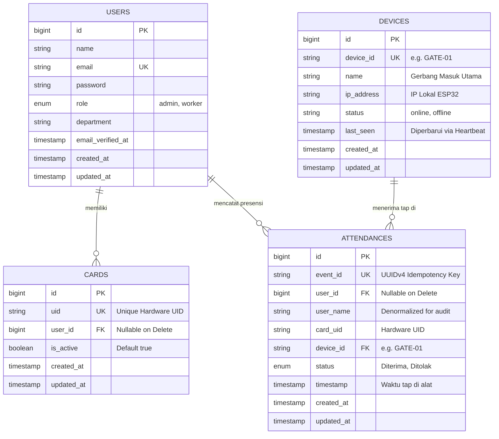

# 🗄️ Database Architecture & Schemas — NFCKey System

Dokumentasi rancangan basis data relasional untuk sistem **NFCKey (Smart NFC Attendance & Door Access System)**. Mendukung implementasi pada **PostgreSQL (Supabase Cloud)** serta **MySQL / SQLite (Laravel 11/12/13)**.

---

## 📊 1. Entity Relationship Diagram (ERD)

---

## 📋 2. Skema Tabel Detail

### A. Tabel `users`
Menyimpan akun pengguna, mencakup administrator dan anggota (siswa/staf).

| Kolom | Tipe Data | Constraint | Keterangan |
| :--- | :--- | :--- | :--- |
| `id` | `BIGINT` | PRIMARY KEY, AUTO_INCREMENT | Identifier unik pengguna. |
| `name` | `VARCHAR(255)` | NOT NULL | Nama lengkap pengguna (misal: *Siswa Teladan*). |
| `email` | `VARCHAR(255)` | UNIQUE, NOT NULL | Alamat email untuk login web. |
| `password` | `VARCHAR(255)` | NOT NULL | Hash kata sandi (`bcrypt`). |
| `role` | `ENUM` | DEFAULT `'worker'` | Hak akses (`admin` atau `worker`). |
| `department`| `VARCHAR(255)` | NULLABLE | Kelas / Divisi (misal: *XI-TKJ-1*). |
| `created_at`| `TIMESTAMP` | NULLABLE | Waktu pendaftaran akun. |
| `updated_at`| `TIMESTAMP` | NULLABLE | Waktu perubahan terakhir. |

---

### B. Tabel `cards`
Menyimpan identitas kartu fisik NFC (ISO14443A) atau RFID (Mifare Classic 1K) yang terdaftar.

| Kolom | Tipe Data | Constraint | Keterangan |
| :--- | :--- | :--- | :--- |
| `id` | `BIGINT` | PRIMARY KEY, AUTO_INCREMENT | Identifier unik kartu. |
| `uid` | `VARCHAR(64)` | UNIQUE, NOT NULL | Nilai heksadesimal UID kartu fisik (misal: `04:A3:92:7F`). |
| `user_id` | `BIGINT` | FOREIGN KEY → `users(id)`, NULL ON DELETE | Relasi ke pemilik kartu. |
| `is_active`| `BOOLEAN` | DEFAULT `true` | Status aktif/blokir kartu. |
| `created_at`| `TIMESTAMP` | NULLABLE | Waktu kartu didaftarkan. |
| `updated_at`| `TIMESTAMP` | NULLABLE | Waktu kartu diubah statusnya. |

---

### C. Tabel `attendances` (Inti Idempotensi & Audit)
Menyimpan seluruh catatan event penempelan kartu.

| Kolom | Tipe Data | Constraint | Keterangan |
| :--- | :--- | :--- | :--- |
| `id` | `BIGINT` | PRIMARY KEY, AUTO_INCREMENT | Identifier rekaman. |
| **`event_id`**| `VARCHAR(64)`| **UNIQUE, NOT NULL** | **Kunci idempotensi (UUIDv4) untuk mencegah duplikasi tap.** |
| `user_id` | `BIGINT` | FOREIGN KEY → `users(id)`, NULL ON DELETE | Relasi ke pengguna (null jika kartu tak terdaftar). |
| `user_name`| `VARCHAR(255)` | NULLABLE | Salinan nama pengguna saat tap dilakukan (audit integrity). |
| `card_uid` | `VARCHAR(64)` | NOT NULL | Salinan UID kartu saat transaksi. |
| `device_id`| `VARCHAR(64)` | NOT NULL, INDEX | Lokasi gerbang fisik (misal: `GATE-01`). |
| `status` | `ENUM` | NOT NULL | Status otorisasi: `'Diterima'` atau `'Ditolak'`. |
| `timestamp`| `TIMESTAMP` | NOT NULL, INDEX | Waktu saat kartu ditempelkan di sensor. |
| `created_at`| `TIMESTAMP` | NULLABLE | Waktu server menerima event. |
| `updated_at`| `TIMESTAMP` | NULLABLE | Waktu pembaruan. |

---

### D. Tabel `devices`
Menyimpan daftar gerbang IoT / gateway ESP32.

| Kolom | Tipe Data | Constraint | Keterangan |
| :--- | :--- | :--- | :--- |
| `id` | `BIGINT` | PRIMARY KEY, AUTO_INCREMENT | Identifier unik database. |
| `device_id`| `VARCHAR(64)` | UNIQUE, NOT NULL | Kode pengenal perangkat (misal: `GATE-01`). |
| `name` | `VARCHAR(255)`| NOT NULL | Nama lokasi gerbang (misal: *Pintu Masuk Lab IoT*). |
| `ip_address`| `VARCHAR(45)` | NULLABLE | Alamat IPv4 lokal perangkat saat heartbeat. |
| `status` | `VARCHAR(32)` | DEFAULT `'offline'` | Status operasional perangkat. |
| `last_seen`| `TIMESTAMP` | NULLABLE, INDEX | Diperbarui setiap 20 detik oleh heartbeat ESP32. |
| `created_at`| `TIMESTAMP` | NULLABLE | Waktu gerbang didaftarkan. |
| `updated_at`| `TIMESTAMP` | NULLABLE | Waktu pembaruan data gerbang. |

---

## ⚡ 3. Indeks & Optimalisasi Kueri

Untuk menjamin latensi baca dashboard di bawah 50ms saat jumlah rekaman bertambah:

1. **`attendances_event_id_unique` (`event_id`):**
   Constraint unik tingkat database yang menjamin idempotensi transmisi ulang offline.
2. **`attendances_device_timestamp_idx` (`device_id`, `timestamp` DESC):**
   Mempercepat filter log presensi harian per gerbang pintu.
3. **`cards_uid_unique` (`uid`):**
   Mendukung kueri O(1) saat verifikasi kartu dari mikrokontroler.
4. **`devices_last_seen_idx` (`last_seen`):**
   Mendukung kueri penentuan liveness gateway secara real-time.

---

## 🔄 4. Data Seeder Awal (Initial Seeders)

Sistem telah dilengkapi dengan seeder otomatis pada `backend/laravel/database/seeders/DatabaseSeeder.php`:

* **Super Admin**:
  * Email: `admin@nfckey.com`
  * Password: `password123`
  * Role: `admin`
* **Default Device**:
  * `device_id`: `GATE-01`
  * `name`: `Pintu Masuk Utama Lab`
* **Default Whitelist Card**:
  * `uid`: `04:A3:92:7F` (Siswa Teladan)
  * Status: `is_active = true`
