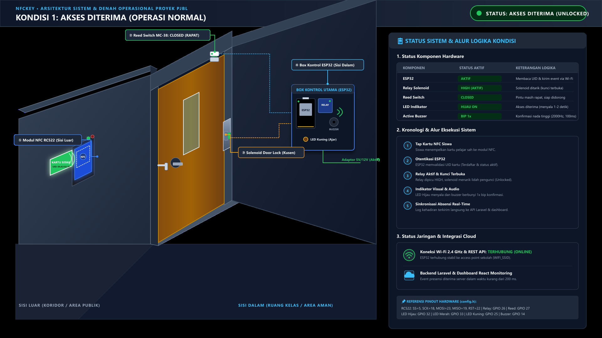
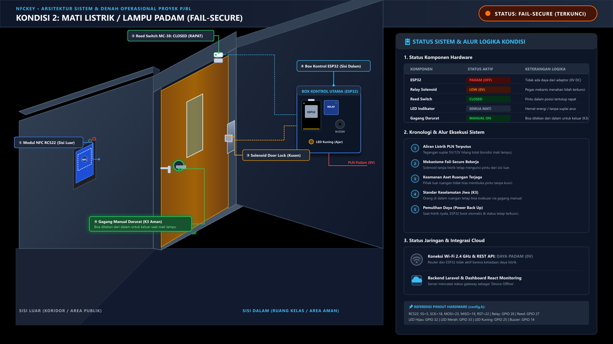
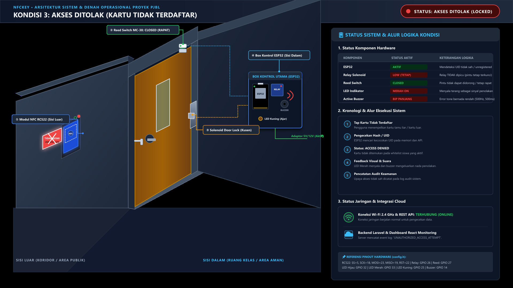
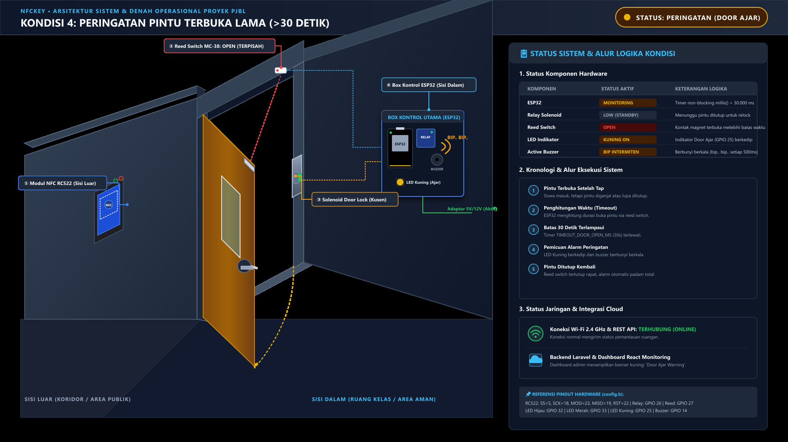
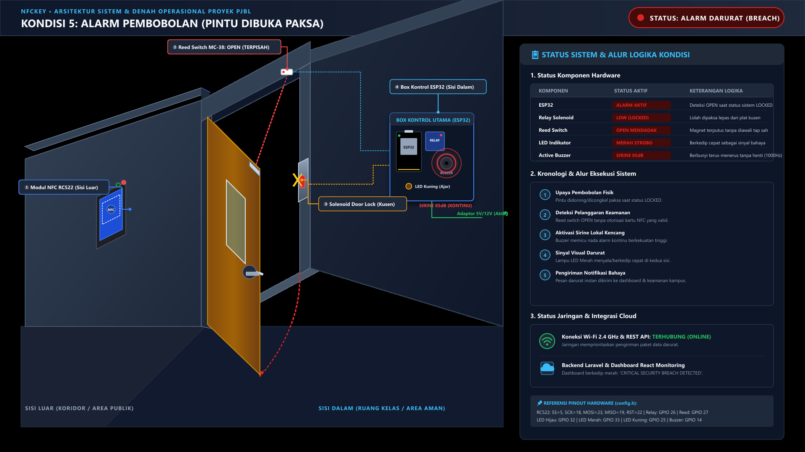
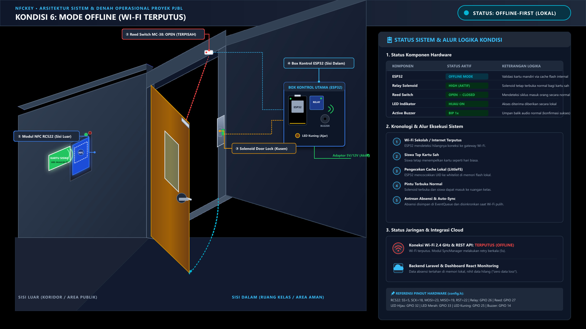

# Denah Proyek & Matriks Skenario Kondisi Operasional (Condition 1 – 6)

**Proyek:** NFCKey - Smart NFC Attendance & Door Access System  
**Mikrokontroler:** ESP32 (WROOM-32)  
**Komponen Utama:** Modul RFID/NFC RC522, Solenoid Door Lock, Relay 1-Channel, Sensor Magnetik Reed Switch (MC-38), Active Buzzer, LED Indikator (Hijau, Merah, Kuning).  
**Lokasi Gambar:** `docs/conditions/`

---

## 1. Denah Fisik & Tata Letak Komponen (Floor Plan & Placement)

Penempatan komponen dirancang dengan memisahkan **Sisi Luar (Public/Unsecured Side)**, **Kusen Pintu**, dan **Sisi Dalam (Secure Side)** untuk menjamin integritas keamanan fisik:

```text
======================= SISI LUAR (PUBLIC SIDE) =======================
  [ Dinding Luar ]                                  [ Daun Pintu ]
   +-----------------------------+                  +------------+
   |  Modul RFID/NFC (RC522)     |                  |            |
   |  LED Hijau (Akses Diterima) |                  |            |
   |  LED Merah (Akses Ditolak)  |                  |            |
   +-----------------------------+                  |            |
   (Tinggi ~120 cm dari lantai)                     |            |
================================ KUSEN PINTU ==========================
       [ Kusen Tetap ]                              [ Daun Pintu Bergerak ]
       - Reed Switch MC-38 (Bagian Kabel)   <====>  - Magnet Reed Switch
       - Solenoid Door Lock (Lidah Kunci)   <====>  - Plat Penahan Kusen
======================= SISI DALAM (SECURE SIDE) ======================
  [ Box Enclosure Kontroler di Dinding Dalam ]
   +-------------------------------------------------------+
   |  - ESP32 Microcontroller Board                        |
   |  - Modul Relay 1-Channel 5V (Driver Solenoid)         |
   |  - Active Buzzer (Alarm & Audio Feedback)             |
   |  - LED Kuning (Indikator Pintu Terbuka Lama / Ajar)   |
   |  - Power Supply Adaptor 5V/12V DC                     |
   |  - Handle Manual Darurat / Mechanical Thumbturn       |
   +-------------------------------------------------------+
         ▲
         │ (Koneksi Nirkabel Wi-Fi 2.4 GHz)
         ▼
   [ Wi-Fi Router / Access Point ] ───▶ [ Laravel Backend API & React Dashboard ]
```

---

## 2. Rincian 6 Skenario Kondisi Operasional

### 🟢 Condition 1: Normal Operation (Working as Expected)


* **Deskripsi:** Kondisi standar di mana kartu siswa yang terdaftar di-tap pada pembaca kartu saat listrik dan jaringan Wi-Fi normal.
* **Alur Kerja:**
  1. Siswa menempelkan kartu NFC/RFID ke pembaca RC522.
  2. ESP32 membaca UID dan mencocokkan ke database/cache.
  3. Status terverifikasi $\rightarrow$ Relay dipicu `HIGH`, solenoid menarik lidah pengunci (*Door Unlocked*).
  4. LED Hijau (GPIO 32) menyala dan Buzzer (GPIO 14) berbunyi 1x bip pendek.
  5. Pintu didorong terbuka $\rightarrow$ Reed switch (GPIO 27) berubah menjadi `OPEN`.
  6. Siswa masuk dan pintu tertutup kembali $\rightarrow$ Reed switch berubah menjadi `CLOSED`.
  7. Relay kembali ke `LOW` (*Door Locked*).
  8. Log presensi siswa dikirimkan langsung ke backend Laravel dan dashboard pemantau.

---

### ⚡ Condition 2: Lights Out / Power Outage (Mati Listrik s.d. Listrik Pulih)


* **Deskripsi:** Terjadi pemadaman listrik PLN total atau kabel daya terputus.
* **Perilaku Kunci (Fail-Secure vs Fail-Safe):**
  * Solenoid yang digunakan berjenis **Fail-Secure (Normally Closed)**.
  * **Saat Mati Listrik:** Tanpa tegangan listrik (0V DC), pegas mekanis mendorong lidah solenoid tetap mengunci rapat. **Pintu tetap TERKUNCI dari luar** sehingga aset sekolah/ruangan tetap aman dari pihak luar.
  * **Aspek Keselamatan Jiwa (Life-Safety Egress):** Di sisi dalam pintu dilengkapi gagang manual darurat (*mechanical panic handle/thumbturn*) yang memungkinkan evakuasi keluar ruangan tanpa membutuhkan listrik sama sekali.
* **Saat Listrik Menyala Kembali (Power Back Up):**
  1. ESP32 otomatis *cold-boot* dan menjalankan inisialisasi pin (`door_init`).
  2. Relay langsung diset ke `LOW` (memastikan kunci tetap aman terkunci).
  3. Membaca sensor reed switch untuk memastikan pintu dalam posisi tertutup rapat.
  4. ESP32 menghubungkan ulang koneksi Wi-Fi dan sinkronisasi jam sistem via NTP.

---

### 🔴 Condition 3: Access Denied (Kartu Tidak Terdaftar / Izin Ditolak)


* **Deskripsi:** Seseorang menempelkan kartu NFC/RFID yang tidak terdaftar di sistem atau kartu yang sudah dinonaktifkan.
* **Alur Kerja:**
  1. Kartu tidak dikenal di-tap pada modul RC522.
  2. ESP32 melakukan pengecekan UID dan menghasilkan status *UNAUTHORIZED / NOT FOUND*.
  3. Relay **TETAP OFF (LOW)** $\rightarrow$ Solenoid tetap mengunci rapat. Pintu **TIDAK** terbuka.
  4. LED Merah (GPIO 33) menyala dan Buzzer berbunyi panjang bernada rendah (error beep).
  5. Log penolakan akses dicatat ke memori/server untuk monitoring upaya akses ilegal.

---

### ⚠️ Condition 4: Door Ajar Alert (Pintu Terbuka Terlalu Lama > 30 Detik)


* **Deskripsi:** Pintu telah dibuka setelah tap valid, tetapi pintu diganjal atau lupa ditutup rapat melebihi batas waktu toleransi (`TIMEOUT_DOOR_OPEN_MS = 30000`).
* **Alur Kerja:**
  1. Sensor Reed Switch mendeteksi status `OPEN`. Timer non-blocking `millis()` mulai berjalan.
  2. Jika pintu tetap `OPEN` melebihi 30 detik:
     * LED Kuning (GPIO 25) menyala/berkedip amber peringatan.
     * Buzzer berbunyi intermiten secara berkala (*Beep... Beep...*).
     * ESP32 mengirimkan notifikasi *Door Ajar Alert* ke dashboard admin web.
  3. Segera setelah pintu ditutup rapat (`Reed Switch = CLOSED`):
     * Alarm buzzer dan LED Kuning langsung mati.
     * Solenoid kembali mengunci rapat dan sistem kembali ke status `LOCKED`.

---

### 🚨 Condition 5: Forced Entry / Tamper Intrusion (Pintu Dibobol Paksa)


* **Deskripsi:** Pintu dibuka paksa (didobrak atau dicongkel) saat sistem berada dalam status `LOCKED` tanpa diawali tap kartu NFC yang sah.
* **Alur Kerja:**
  1. Sistem berada dalam state `LOCKED` (belum ada otentikasi sah).
  2. Sensor Reed Switch mendeteksi perubahan mendadak dari `CLOSED` ke `OPEN`.
  3. ESP32 langsung mendeteksi pembobolan keamanan (*Security Breach*).
  4. Buzzer aktif membunyikan sirine alarm kencang secara terus-menerus (continuous tone).
  5. LED Merah berkedip cepat (strobe warning).
  6. ESP32 memicu pesan darurat prioritas tinggi (*CRITICAL: DOOR_FORCED*) ke dashboard web dan ponsel administrator.
  7. Alarm hanya berhenti jika pintu ditutup kembali atau di-reset oleh kartu pengawas/admin.

---

### 📡 Condition 6: Offline-First Operation (Wi-Fi / Server Down)


* **Deskripsi:** Listrik ruangan menyala, namun jaringan Wi-Fi sekolah terputus atau server backend sedang offline.
* **Alur Kerja:**
  1. Siswa menempelkan kartu NFC yang sah.
  2. ESP32 mendeteksi ketiadaan koneksi Wi-Fi dan langsung mengaktifkan logika **Offline-First**.
  3. ESP32 memvalidasi UID kartu secara lokal melalui cache memori flash internal (`LittleFS`/SPIFFS whitelist).
  4. Kartu dinyatakan valid $\rightarrow$ Solenoid membuka pintu secara normal dan LED Hijau menyala.
  5. Data presensi dibuat dengan UUID unik (`event_id`) dan disimpan ke dalam antrean offline lokal (`EventQueue`).
  6. Ketika Wi-Fi/server kembali online:
     * Komponen `SyncManager` mendeteksi koneksi pulih.
     * Seluruh antrean absensi offline otomatis diunggah (*batch sync*) ke server tanpa ada data hilang atau ganda (*idempotent sync*).

---

## 3. Matriks Pinout & Konfigurasi Hardware ESP32

Berdasarkan konfigurasi pada firmware `firmware/esp32/src/config.h`:

| Komponen | Pin ESP32 | Mode GPIO | Fungsi |
|---|---|---|---|
| **RC522 SDA/SS** | GPIO 5 | Output | SPI Chip Select |
| **RC522 SCK** | GPIO 18 | Output | VSPI Clock |
| **RC522 MOSI** | GPIO 23 | Output | VSPI Master Out Slave In |
| **RC522 MISO** | GPIO 19 | Input | VSPI Master In Slave Out |
| **RC522 RST** | GPIO 22 | Output | Reset pin modul RFID |
| **Relay Solenoid** | GPIO 26 | Output | Trigger driver solenoid (HIGH = Buka, LOW = Kunci) |
| **Reed Switch** | GPIO 27 | Input Pull-Up | Sensor magnet pintu (LOW = Tertutup, HIGH = Terbuka) |
| **Active Buzzer** | GPIO 14 | Output | Audio feedback & sirine alarm |
| **LED Hijau** | GPIO 32 | Output | Indikator akses diterima |
| **LED Merah** | GPIO 33 | Output | Indikator akses ditolak & alarm pembobolan |
| **LED Kuning** | GPIO 25 | Output | Indikator pintu terbuka terlalu lama (Door Ajar) |
